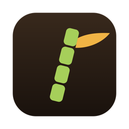
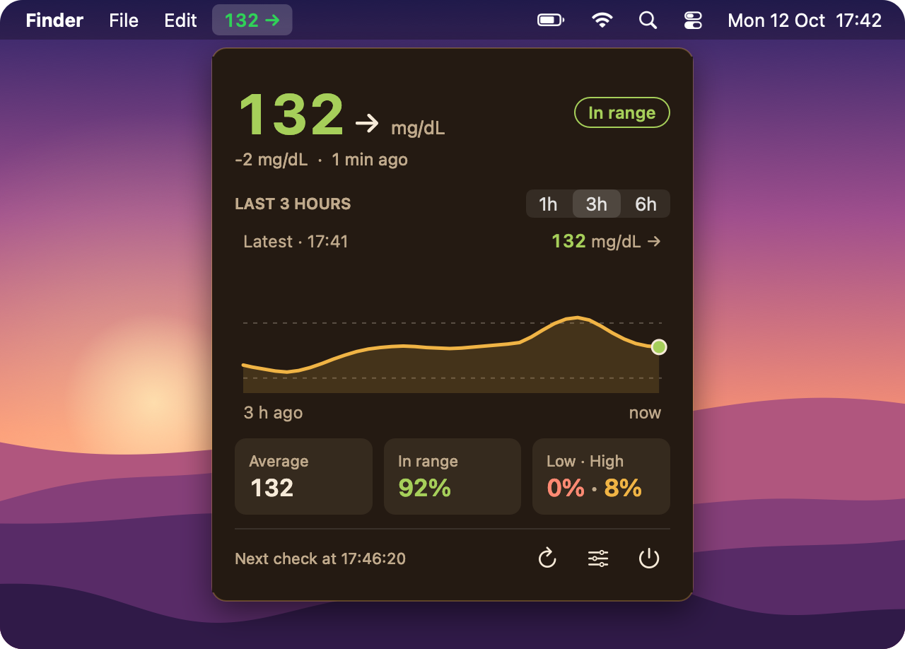
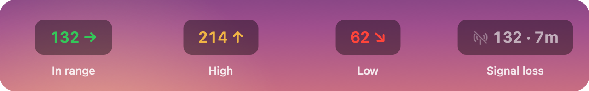
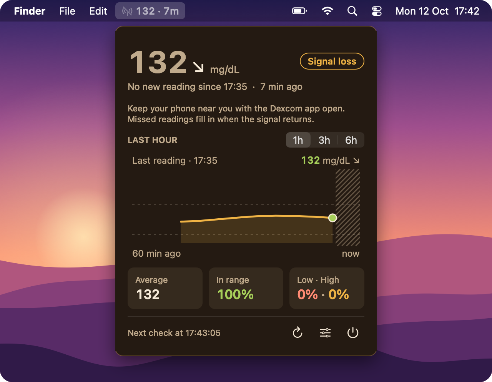
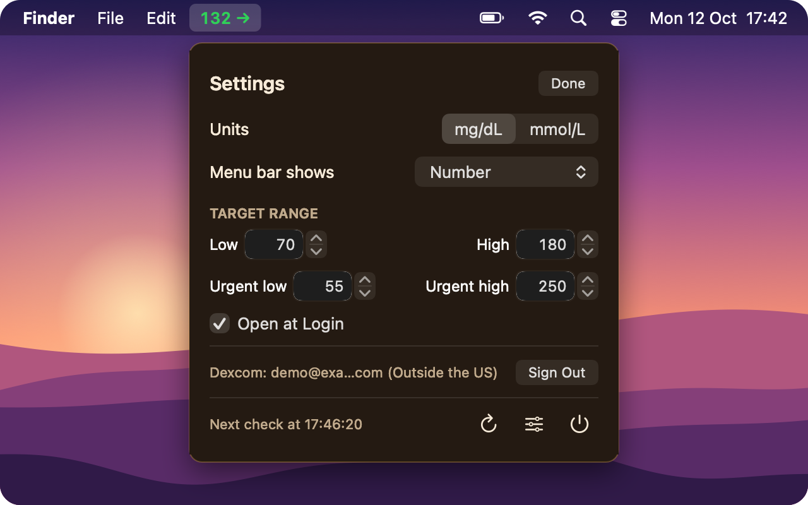

# Sugarcane

**Your Dexcom glucose in the macOS menu bar.**

Sugarcane shows your latest reading and trend arrow in the menu bar, colored by range. Click it for the details, a graph of the last 1, 3 or 6 hours, and your average and time in range for that period. It reads from **Dexcom Share**, the service behind the Dexcom Follow app.

> **Not a medical device.** Sugarcane is unofficial and not affiliated with Dexcom. Readings can be delayed or missing. Always use your Dexcom app or receiver for alerts and treatment decisions.

## Install

1. Download **`Sugarcane-<version>.pkg`** from the [latest release](https://github.com/yuvalezrati/sugarcane/releases/latest) and double-click it.
2. macOS blocks it the first time, because Sugarcane isn't signed with a paid Apple Developer ID. Click **Done**, open **System Settings → Privacy & Security**, scroll down and click **Open Anyway**.
3. Sugarcane opens in the menu bar with a sign-in panel. Enter your Dexcom username and password, choose your region and click **Sign In**.

**Before you start:** turn on **Share** in the Dexcom app and invite at least one follower (it can be yourself on a second email address). Sugarcane needs macOS 12 or later.

To update, install the newer `.pkg`; you stay signed in. After an update, macOS asks once whether Sugarcane may use its saved password: enter your Mac password and click **Allow**. To uninstall, quit Sugarcane and drag it from Applications to the Trash.

## What you see

Green is in range (70–180 mg/dL by default), yellow is high and red is low. A hollow gray circle means you're not signed in.

When a reading is late, Sugarcane shows **Signal loss** with the last value and its age, instead of passing off an old number as live:

These pictures are drawn by Sugarcane's own code with demo readings, on an illustrated desktop.

## Settings

Click the settings button at the bottom of the panel to choose mg/dL or mmol/L, what the menu bar shows, your target range and the urgent thresholds. Changes apply straight away.

## Privacy

Your password is stored only in your Mac's Keychain, and Sugarcane talks only to Dexcom's Share servers. **Sign Out** on the settings page removes the saved password. If Dexcom rejects the password, Sugarcane stops trying so your account doesn't get locked.

## Troubleshooting

- **Wrong username or password.** Check the region first: accounts registered outside the US must use "Outside the US".
- **Signed in, but no readings.** Make sure Share is on in the Dexcom app with at least one follower.
- **Nothing in the menu bar.** On MacBooks with a notch, extra items can hide behind it. Quit a few other menu bar apps.

## License

[MIT](LICENSE). Developers: see [scripts/](scripts/) to build Sugarcane from source.
